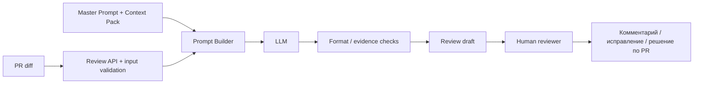

# ADR: решение для первого рабочего сценария

- Статус: accepted
- Дата: 2026-09-28
- Ответственные: студент; человеческий ревьюер как финальная точка принятия решения

## Контекст

Нужен AI-помощник для первичного анализа diff Pull Request. Главная ценность — ускорить первый проход, но не передать модели право принимать решение по PR. Из практики известно, что ответ должен быть коротким, доказательным и воспроизводимым: summary, до трёх рисков и проверки.

## Решение

Использовать схему **human-in-the-loop**:

1. сервис принимает один diff;
2. добавляет versioned Master Prompt и Context Pack;
3. LLM формирует только структурированный черновик ревью;
4. перед показом пользователю результат проверяется на формат: максимум три риска, наличие ссылки на место и проверки;
5. ревьюер вручную принимает, исправляет или отклоняет предложения;
6. никакие действия approve/merge/change code не выполняются автоматически.

Для API желательно заменить необобщённый `dict` на явную входную модель с обязательным строковым `diff` и ограничением размера. Это снижает риск необработанного `KeyError` и неконтролируемого объёма запроса.

## Рассмотренные альтернативы

| Альтернатива | Почему не выбрали сейчас |
|---|---|
| Полностью автоматическое ревью с публикацией комментариев | слишком высокий риск ложных уверенных замечаний; нарушает требование, что решение принимает человек |
| Передавать модели весь репозиторий | увеличивает объём контекста и риск использования нерелевантных/секретных данных; для первого сценария достаточно diff + Context Pack |
| Только статические правила без LLM | хорошо для формальных ошибок, но хуже подходит для краткого смыслового summary и объяснения рисков |

## Последствия и главный риск

- Положительные последствия: меньше ручной рутины на первом проходе; единый формат комментариев; легче проверять выводы AI.
- Ограничения: качество зависит от качества Context Pack и модели; часть архитектурных проблем невозможно доказать по одному diff.
- Главный риск: модель сформулирует правдоподобное, но неподтверждённое замечание как факт.
- Как проверим риск: пилот на размеченных diff; считать долю ложных уверенных замечаний и долю рисков с доказательством; неподтверждённые выводы должны маркироваться как гипотезы.

## Архитектурная схема

## Как использовали AI

- Для чего: выбрать минимальную архитектуру, которая сохраняет ответственность у человека.
- Тип промпта: ADR prompting + comparison of alternatives.
- Строка в [`prompts.md`](prompts.md): `P1-08`.
- Что проверил студент и какие исправления поручил агенту: запретил автоматическую публикацию/merge; добавил валидацию входа и проверку доказательности перед human review.
