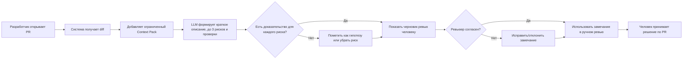

# Анализ процесса: AS IS и TO BE

## AS IS

1. Разработчик открывает Pull Request.
2. Ревьюер вручную читает diff.
3. Ревьюер пытается понять назначение изменений и найти ошибки.
4. Если контекста недостаточно, ревьюер ищет дополнительные файлы или задаёт вопросы.
5. Ревьюер вручную формулирует комментарии и список проверок.
6. Разработчик отвечает или исправляет код.

Основные потери: повторяющийся первичный просмотр, риск слишком общих комментариев, зависимость качества от усталости и времени ревьюера, отсутствие единого формата доказательств.

## TO BE

В TO BE AI не заменяет ревьюера: он сокращает первичный аналитический проход и приводит замечания к проверяемому формату.

## Разница

| Что меняется | AS IS | TO BE | Как проверим изменение |
|---|---|---|---|
| Первичный анализ | полностью вручную | AI готовит черновик, человек проверяет | замер времени на одинаковой выборке PR |
| Формат замечаний | зависит от ревьюера | файл/место + доказательство + проверка | ручная разметка 20 ответов |
| Работа с неопределённостью | может смешиваться с фактом | неподтверждённое помечается как гипотеза | проверить ответы на diff с недостаточным контекстом |
| Ответственность | человек | человек; AI только предлагает | убедиться, что в интерфейсе/ответе нет approve/merge |

## Как использовали AI

- Для чего: описать текущий и целевой процесс и выделить точки контроля человеком.
- Тип промпта: process decomposition + Chain of Verification.
- Строка в [`prompts.md`](prompts.md): `P1-05`.
- Что проверил студент и какие исправления поручил агенту: добавил явный human-in-the-loop и ветку для неподтверждённых рисков; убрал автоматический merge.
