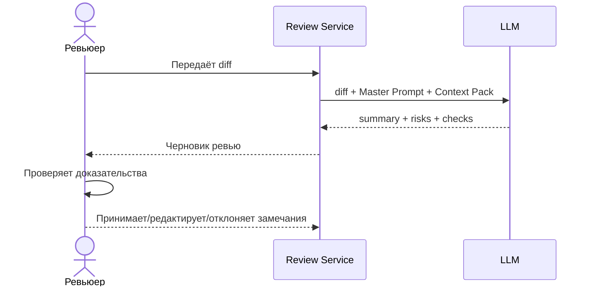

# Use cases и user stories

## Первый рабочий сценарий

**Когда** ревьюер получает Pull Request с diff, **система** передаёт diff и Context Pack в LLM и формирует структурированный черновик ревью, **а пользователь получает** краткое описание изменения, не более трёх доказанных рисков и список воспроизводимых проверок.

Не входит в этот сценарий:

- автоматическое исправление кода;
- approve, merge или reject PR от имени человека;
- чтение произвольных файлов вне разрешённого контекста;
- публикация комментариев без предварительной проверки человеком.

## Use case

| Поле | Значение |
|---|---|
| Актор | Ревьюер Pull Request |
| Триггер | Пользователь передал diff на первичный анализ |
| Предусловия | diff доступен как текст; Context Pack определяет формат и ограничения |
| Основной результат | структурированный черновик: summary, до 3 рисков, проверки |
| Ошибка или отказ | если вход отсутствует/невалиден — явная ошибка; если доказательств недостаточно — гипотеза помечается или не включается |



## User stories и acceptance criteria

**US-1.** Как ревьюер, я хочу получить краткое описание изменений, чтобы быстрее понять назначение PR.

**US-2.** Как ревьюер, я хочу видеть не более трёх наиболее существенных рисков с доказательствами, чтобы не тратить время на общие советы.

**US-3.** Как ревьюер, я хочу получить воспроизводимые проверки, чтобы быстро подтвердить или опровергнуть замечание AI.

```gherkin
Feature: Черновик AI-review для одного Pull Request

  Scenario: Позитивный
    Given передан непустой diff учебного PR
    And Context Pack запрещает approve и изменение кода
    When система формирует ревью
    Then ответ содержит краткое описание изменения
    And содержит не более трех рисков
    And каждый риск содержит файл или фрагмент diff, доказательство и способ проверки
    And ответ содержит список проверок

  Scenario: Негативный или граничный
    Given запрос не содержит поля diff
    When пользователь вызывает POST /api/reviews
    Then сервис не должен завершаться необработанным KeyError
    And пользователь получает контролируемую ошибку валидации
```

## Как использовали AI

- Для чего: преобразовать проблему в один сквозной use case, user stories и acceptance criteria.
- Тип промпта: few-shot по примеру хорошего/плохого комментария + RCTF.
- Строка в [`prompts.md`](prompts.md): `P1-06`.
- Что проверил студент и какие исправления поручил агенту: ограничил сценарий одним PR, добавил негативный кейс из `TRAINING_PR.diff`, исключил автопубликацию и merge.
