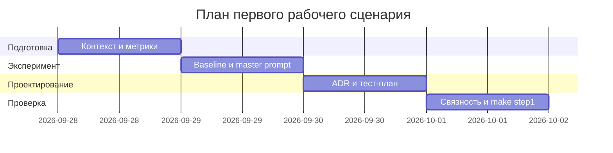

# План поставки

## Инкременты и ответственность

| Инкремент | Наблюдаемый результат | Что делает человек | Что делает AI или субагент | Проверка | Зависимости |
|---|---|---|---|---|---|
| 1. Контекст и формат | заполнены Context Pack, проблема и критерии качества | подтверждает факты и неизвестные требования | структурирует контекст и предлагает метрики | ревью `context.md`, `problem.md`, `make step1` | учебный кейс и diff |
| 2. Черновик review-пайплайна | master prompt выдаёт summary, ≤3 рисков и checks | запускает один и тот же diff, оценивает ответ | выполняет baseline и master-prompt review | сравнение P1-01/P1-02 | инкремент 1 |
| 3. План тестирования и ADR | есть согласованная архитектура и unit/integration/load/e2e проверки | принимает архитектурные границы и DoD | предлагает связный ADR и тест-план | проверка трассировки требований → тестов, `make step1` | инкременты 1–2 |

## Диаграмма Ганта

Роли: студент отвечает за требования, оценку и финальное решение; AI предлагает структуру, формулировки и черновики; внешний ревьюер проверяет связность и доказательность, но не подменяет решение студента.

## Как использовали AI

- Для чего: разбить работу на проверяемые инкременты и развести ответственность человека и AI.
- Тип промпта: decomposition / planning.
- Строка в [`prompts.md`](prompts.md): `P1-07`.
- Что проверил студент и какие исправления поручил агенту: сократил план до трёх инкрементов; для каждого добавил наблюдаемый результат и проверку; человек оставлен владельцем решений.
