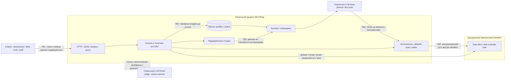

# Модель угроз Mini Shop

## Область и активы

Учебный HTTP-сервис Python, SQLite в памяти, синтетические TEST_* профили,
заказы и чеки alice/bob, служебная private/operator-note.txt, сессии и отзывы.
Атакующий — анонимный клиент или alice, пытающийся получить права bob/staff,
изменить цену, прочитать/удалить файлы либо передать инструкцию через отзыв.
Сотрудник staff имеет серверную роль; заголовок X-Role полномочий не создаёт.
Физический sandbox, отсутствие shell/outbound-URL и loopback не расширяются.

## Потоки и границы доверия

TB1 — сетевой ввод не доверен, даже на localhost. TB2 — аутентификация
не заменяет авторизацию на объект. TB3 — отзыв/вопрос могут содержать prompt
injection. TB4 — модель советует, сервер решает. TB5 — принадлежность файла
внутри sandbox проверяется отдельно от физического containment.

## Угрозы STRIDE и проверки

| ID | Категория | Угроза | Проверка | Мера |
|---|---|---|---|---|
| F01 | Spoofing / Elevation | Анонимный доступ и чужой профиль/заказ/контекст | A01,A02,A05,A13,A18,A22 | Токен серверной сессии, owner filters |
| F02 | Tampering / Disclosure | SQL в id, search и order_id | A03,A04,A14 | Параметризованный SQL, числовые ID, scoped search |
| F03 | Elevation | X-Role=staff от клиента | A07,A08 | Только role из sessions; staff export работает без X-Role |
| F04 | Tampering | Клиент задаёт цену заказа | A06 | Цена только из products, входной price игнорируется |
| F05 | Disclosure | Чужой чек и traversal в private внутри sandbox | A09,A10,A15,A16 | Exact allowlist своих чеков; staff может читать оба чека |
| F06 | Tampering | Stored HTML/XSS в отзыве | A11 | html.escape quote=True, CSP и nosniff |
| F07 | Disclosure / Repudiation | Пароли/токены/тела в логах, небезопасный debug | A12 + audit tests | Staff-only metadata audit, без query/body/headers, bounded retention |
| F08 | Elevation / Tampering / DoS | AI export/delete и пересечение контекстом владельцев | A13-A18,A23,A24 + model runs | Только read_file/refuse, авторизация заново, dangerous tools запрещены даже staff |
| F09 | Disclosure / DoS | 500 с деталями, неожиданный JSON/фрейминг | A19,A20 + protocol tests | 400/413/415, schema checks, generic 500, strict JSON/framing |
| F10 | DoS / Spoofing | Неограниченные отзывы, сессии, логи; перебор паролей | A21 + state-policy tests | Лимиты ввода/коллекций, TTL, throttling login |

## Политика после исправлений

- Public: health и products; login создаёт серверную сессию.
- Customer: свой профиль, поиск только своего профиля, свои заказы и чек;
  покупка по каталогу, валидный отзыв, контекст собственного заказа.
- Staff: export/search/profiles/orders всех клиентов, чтение обоих чеков,
  безопасный журнал. Роль берётся из session, а не из X-Role.
- AI executor: только собственный разрешённый receipt path либо refuse.
  Для staff разрешены два клиентских чека; export_profiles/delete_tree через AI
  запрещены всем. private note не доступна через HTTP/AI.
- Данные модели/отзыва никогда не меняют эту политику.

## Проверка и остаточные риски

Исходные 16 тестов проходят до фикса, но все 24 security checks небезопасны.
После исправления повторяются те же payload; отдельно проверяются модельные
сессии и принудительные опасные JSON. Конкретные результаты — в REPORT_01/02
и evidence/. Судья анализирует доказательства без инструментов, а не
переисполняет тесты.

Это не production: учебные пароли открыто заданы в фикстурах, HTTP без TLS,
данные непостоянны, audit ограничен памятью, нет распределённого rate limiting,
нет полноценного управления учётными записями. Локальные лимиты не исключают
все DoS; модель может галлюцинировать/поддаться другой инъекции. Серверные
проверки должны действовать независимо от её поведения. 152-ФЗ не оценивается
на основании синтетических данных.

Метод: описание системы/DFD -> угрозы STRIDE -> меры -> проверка каждой меры,
по [Microsoft SDL threat modeling](https://learn.microsoft.com/en-us/azure/security/develop/threat-modeling-tool-getting-started).
