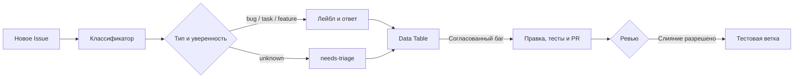

# Дай почитать · AI-поддержка

Условия и баллы перечислены в [README практики 7.2](../README.md). Исходники приложения для эксперимента находятся в тестовой ветке `demo/practice-07.2-booksharing` форка `GlebTV43/ITMOv2`.

## Что открыть в n8n



| Workflow | От чего запускается | Результат |
|---|---|---|
| [Классификатор](workflows/classifier.json) | Execute Sub-workflow Trigger принимает `title` и `body` | VseLLM и Structured Output Parser возвращают `type`, `confidence` |
| [Разметка Issues](workflows/triage.json) | GitHub Trigger на `issues:opened` либо ручной запуск для проверки | Switch, лейблы, ответ для уверенной классификации, Data Table и дедупликация |
| [Недельный отчёт](workflows/weekly.json) | Понедельник, 09:00 МСК, либо ручной запуск | Четыре запроса к GitHub, HTML-письмо в Gmail, запись и сравнение недель, AI-комментарий |
| [Автоисправление](workflows/autofix.json) | Размеченный как `bug` тестовый Issue с разрешением `ai-autofix` либо ручной запуск | Правка в новой ветке, PR, ревью второй моделью и условное слияние |
| [Тестовая предыдущая неделя](workflows/seed-week.json) | Ручной запуск | Строка со значением `source=fixture`. Существующая строка сохраняется |

Чтобы пересобрать экспорты и проверить логику:

```powershell
node build.cjs
node --test workflows.test.cjs
python autofix_worker.py --check
```

## Подключения

- **GitHub API.** Форк должен принимать Issues. Для классификации нужны `Issues: Read and write`, для сверхрезультата — также `Contents: Read and write` и `Pull requests: Read and write`. Для подписки GitHub Trigger при размещении добавьте `Webhooks: Read and write`. Тестовые обращения начинаются с `[7.2] `. Имена лейблов и четыре сценария обращений описаны в [setup-fixtures.cjs](setup-fixtures.cjs).
- **VseLLM.** Для Basic LLM Chain нужен credential типа **OpenAI** с учебным ключом и Base URL `https://litellm.data-light.ru/v1`. Автоисправление использует то же API через сохранённый **Header Auth** из 7.1.
- **Gmail.** Включите Gmail API в Google Cloud, добавьте свой аккаунт как test user в настройках OAuth, создайте OAuth client типа Web application. В Google укажите точный Redirect URL, который показывает credential Gmail в n8n. В n8n сохраните **Gmail OAuth2 API** и нажмите **Sign in with Google**. Адрес получателя задаётся в локальной конфигурации.
- **GitHub webhook.** Для опубликованного триггера GitHub должен видеть HTTPS-адрес n8n. При локальном тесте GitHub Trigger отключается в runtime-копии, а ручной вход получает настоящее обращение через GitHub REST. Оба входа используют одну и ту же логику.

На уже установленном локальном n8n из практики 7.1 можно подготовить версии с привязками к сохранённым Credentials. Поместите в `.local/settings.json` только настройки и названия Credentials:

```json
{
  "localOnly": true,
  "githubCredential": "GitHub account",
  "headerCredential": "Header Auth account",
  "openAiCredential": "VseLLM 7.2",
  "gmailCredential": "Gmail 7.2",
  "issueNumber": 0,
  "autofixIssueNumber": 0,
  "weekEnding": "",
  "reportTo": ""
}
```

Укажите реальный номер вместо нуля для локальных прогонов и адрес получателя. `weekEnding` можно оставить пустым. Для учебного прогона впишите дату понедельника, чтобы явно выбрать неделю и пометить письмо как тестовое. Период отсчитывается от полуночи до полуночи по Москве с исключённой правой границей.

```powershell
node --no-warnings prepare-local.cjs
$env:N8N_USER_FOLDER = (Resolve-Path ../../practice_07.1/n8n/.local).Path
node "$env:N8N_USER_FOLDER/node_modules/n8n/bin/n8n" import:workflow --separate --input=.local/workflows
```

Текущее состояние подтверждений — в [протоколе проверки](VERIFICATION.md).

## Проверка сценариев

Перед запуском разметки опубликуйте вложенные workflow **Классификатор Issue** и **Автоисправление**. n8n 2.48 проверяет опубликованные версии вложенных схем. Для локальной проверки откройте разметку в Editor и используйте ручной запуск. Для боевого webhook сначала настройте адрес n8n, затем опубликуйте саму разметку.

1. Откройте четыре Issues. Проверьте `bug`, `task`, `feature-request`, `needs-triage`. Для неизвестного типа убедитесь, что комментарий отсутствует. Повтор одного номера должен завершиться до вызова классификатора.
2. Запустите [тестовую запись прошлой недели](workflows/seed-week.json), если предыдущих данных ещё нет. В тестовом случае настройте ту же дату понедельника в обоих сценариях.
3. Запустите отчёт вручную. Он запрашивает открытые и закрытые за неделю Issues, открытые и слитые PR. Issues ограничены учебным лейблом, PR — тестовой целевой веткой. Сверьте письмо, Δ, AI-комментарий и строки двух недель.

## Сверхрезультат

Демонстрация ограничена обычным багом каталога. Издание с тем же названием, но другим автором должно появляться раньше других книг автора. Воркфлоу принимает открытый Issue от владельца форка с лейблами `bug` и `ai-autofix`. Модель предлагает одну строку правки, тесты воспроизводят баг на исходном коммите и проверяют исправление. Воркфлоу пушит только в `demo/practice-07.2-fix-<номер>` и создаёт PR в `demo/practice-07.2-booksharing`. Второе ревью может заблокировать слияние. Перед слиянием сверяются область правки, SHA проверенной версии и SHA базы.

Локальный проверяющий процесс запускается командой `python autofix_worker.py` из этой папки. Он слушает `127.0.0.1:5782`, принимает только зафиксированную версию и одну допустимую правку, выполняет тесты в отдельной временной папке и сам ничего в GitHub не пишет. Запускайте его в отдельном PowerShell и остановите через Ctrl+C по завершении.
